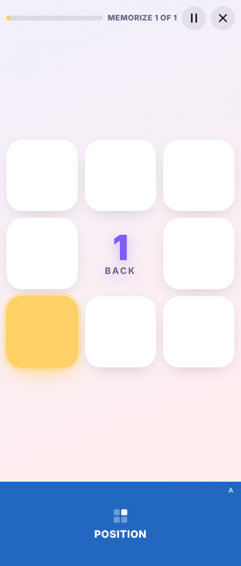
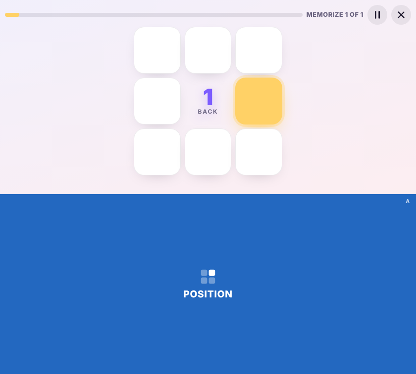
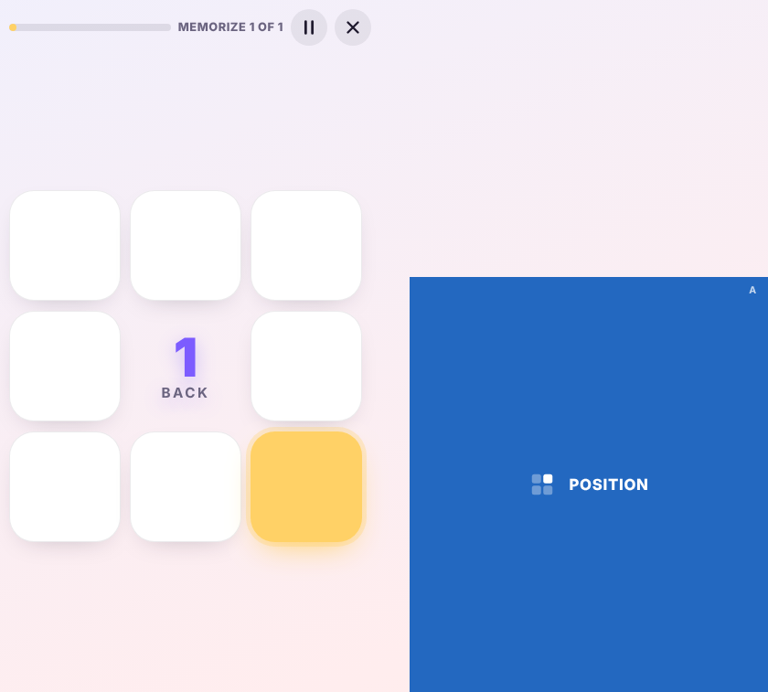
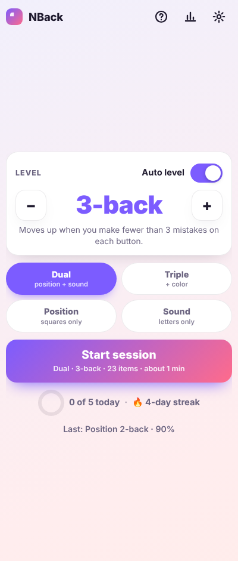
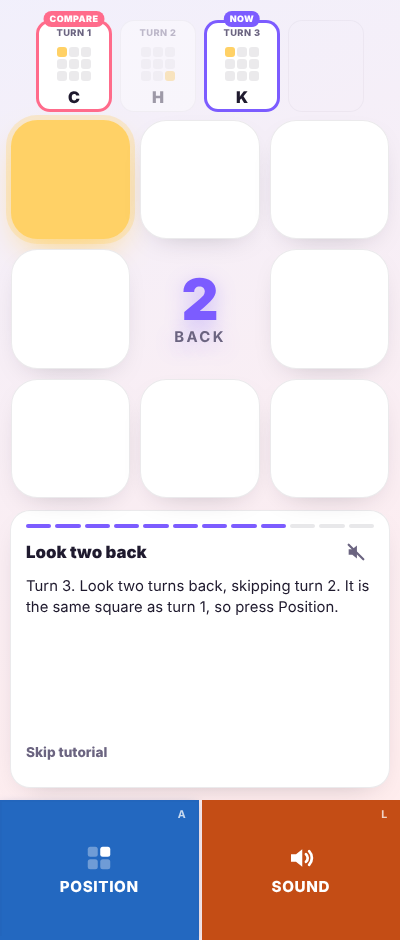
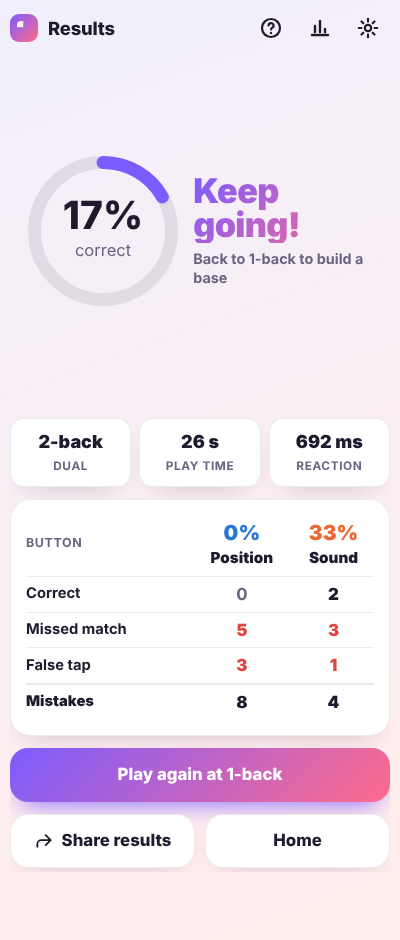
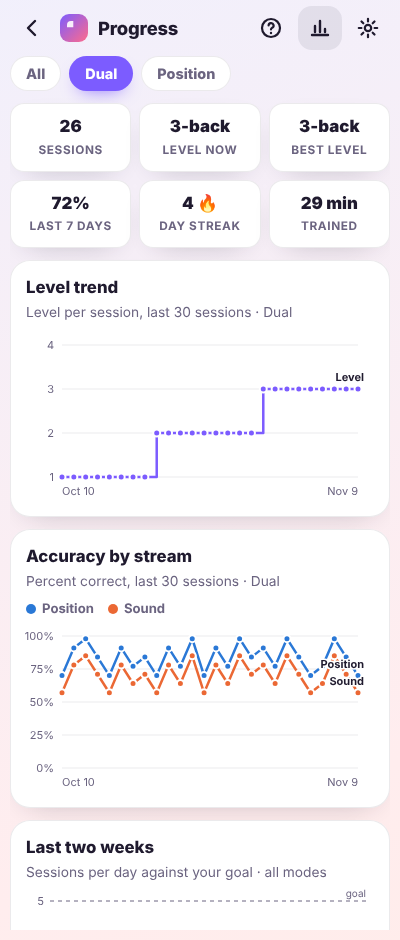

# NBack Trainer

A dual / triple N-back working-memory trainer for Android, designed for foldable phones. It is
built with Capacitor, so the same code also runs as an offline-capable web app. It works on the
cover screen, on the inner screen flat or in landscape, and half-open in tabletop or book posture,
where the grid and the controls sit on opposite screens and nothing straddles the hinge.

| Cover screen | Tabletop (half-open) | Book (half-open) |
|---|---|---|
|  |  |  |

| Home | Guided tutorial | Results | Progress |
|---|---|---|---|
|  |  |  |  |

## The game

Follows the dual N-back task from Jaeggi et al. (2008):

- a 3×3 grid where one of the eight outer squares lights up, while one of eight consonants
  (C H K L Q R S T) is spoken
- a session has 20 + N items, with 6 position targets and 6 sound targets, 2 of them coinciding
- press **Position** when the square matches the one N items ago, **Sound** when the letter does
- the level adapts, **judged per button**: fewer than 3 mistakes on every button raises N, more
  than 5 on any one button lowers it (thresholds scale with session length). A Relaxed rule that
  advances at 80% accuracy is available in Settings.
- each mode keeps its own level; new players start at 1-back
- a 300 ms grace window: a press just after a new item appears counts for the previous item when
  that item had an unanswered target on that button. Misses are only reported once it has closed.

Modes: **Dual**, **Triple** (adds a color stream painted on the lit square, with optional color
names), and single-stream **Position** and **Sound** for focused practice.

## Features

- **Fold-aware layout**: in the Android app, hinge geometry comes from Jetpack WindowManager
  through a small native plugin. In a browser it falls back to the Viewport Segments API, Window
  Segments, CSS `viewport-segments` media queries, and Device Posture events. A session pauses
  itself when the posture changes or the app goes to the background.
- **A play screen that never moves**: the grid and the response zones keep exactly one size and
  position from the countdown to the last item; feedback is color, glow, sound and vibration only.
  Zones glow green for a correct press and red for a wrong one.
- **Guided tutorial with voice-over**: teaches the two buttons at 1-back, then 2-back with a strip
  of recent turns that highlights which one to compare against, and ends with an unhinted 2-back
  practice round. Offered on first launch and under Settings → Learn.
- **Explainer video**: a two-minute narrated animation of six 2-back turns and the rolling-pair
  memory trick. Built from `scripts/explainer/`.
- **Recorded voice and sound design**: letters, narration and every UI sound were generated once
  with ElevenLabs and ship as small MP3 files. Device speech and synthesized tones are fallbacks.
- **Progress**: per-mode level trend and accuracy by button, sessions per day against a goal,
  a 12-week activity heatmap, records, streaks, insights, achievements, and a full session log.
- **Daily reminder**: in the app, dated notifications scheduled two weeks ahead and renewed on
  every launch, skipping days already trained. In a browser, a downloadable calendar alarm.
- **Your data**: stored on the device only. Export a JSON backup or a CSV (through the Android
  share sheet in the app), and import a backup on another device. Everything read from storage or
  a backup file is validated.
- **Accessibility**: zones work with TalkBack and switch access, labels meet contrast guidelines,
  reduced-motion is respected, and the screen stays awake during a session.

## Get the app

Every push to `main` is linted, tested, built and published by GitHub Actions
(`.github/workflows/android.yml`):

- the rolling **dev** prerelease on the Releases page always holds the latest APK from `main`
- pushing a tag such as `v1.2.0` publishes a proper release with the APK and the Play Store bundle
- running the workflow by hand on another branch publishes a **preview** prerelease of that branch

To sign with a stable key, so each build installs over the last one, add repository secrets
`NBACK_KEYSTORE_B64` (`base64 -i nback-release.jks | pbcopy`) and `NBACK_KEYSTORE_PASSWORD`, plus
`NBACK_KEY_ALIAS` / `NBACK_KEY_PASSWORD` if they differ from `nback` and the keystore password.
Without them, dev builds use a throwaway debug key and tagged releases fail on purpose.

## Build locally

Needs Node 22, Android Studio, and the JDK named in `.github/workflows/android.yml`.

```
npm install
npx cap sync android        # copies www/ into the Android project and updates plugins
cd android && ./gradlew installDebug     # or open the android/ folder in Android Studio and press Run
```

For a signed release APK, create a key once (keep the file and passwords safe: the same key must
sign every future update), then build:

```
cd android
keytool -genkeypair -v -keystore nback-release.jks -alias nback -keyalg RSA -keysize 2048 -validity 10000
cp keystore.properties.example keystore.properties   # then fill in the passwords
./gradlew assembleRelease     # → app/build/outputs/apk/release/app-release.apk
```

After editing anything in `www/`, run `npx cap sync android` again before building.

## Run it in a browser

```
npm start                   # serves www/ on http://localhost:8080/
```

To try fold postures on a desktop browser, add `?posture=tabletop` or `?posture=book`
(optionally `&hinge=28` for the hinge width in CSS px) to the URL.

## Develop

```
npm run lint                # ESLint
npm test                    # unit tests: engine, timing, storage (node:test)
npm run e2e                 # end-to-end suite in headless Chromium (needs npm start running)
node scripts/screenshots.mjs        # screenshot gallery on Z Fold viewports (needs npm start)
node scripts/render-icons.mjs       # web PNG icons from www/assets/icon.svg
node scripts/android-icons.mjs      # Android launcher icons, notification icon, splash screens
node scripts/explainer/build.mjs    # rebuild www/video/2back.mp4 (PREVIEW=1 for stills)
```

How the code is organised:

| File | Role |
|---|---|
| `www/js/game.js` | Pure engine: sequence generation, scoring, the level-up rules |
| `www/js/runner.js` | Timing for one session with an injectable clock: trials, grace window, pause and resume |
| `www/js/session.js` | Session state machine: start, countdown, pause, resume, quit, finish |
| `www/js/tutorial.js`, `coach.js` | Tutorial script, and its on-screen coach, narration and turn strip |
| `www/js/views/` | Home, Results, Progress, Settings |
| `www/js/storage.js` | Validated settings, history and backups; calendar-day math |
| `www/js/native.js` | Bridge to the Android shell, with browser fallbacks for every call |
| `www/js/posture.js` | Fold detection; publishes `data-posture`, `data-layout`, `data-width` on `<html>` |
| `www/js/app.js` | Composition root: wires input, lifecycle and the modules together |
| `android/app/src/main/java/…/FoldPlugin.java`, `ScreenPlugin.java` | Hinge geometry and keep-screen-on |

Layout rules live in `www/css/styles.css`, keyed off the posture attributes above.
