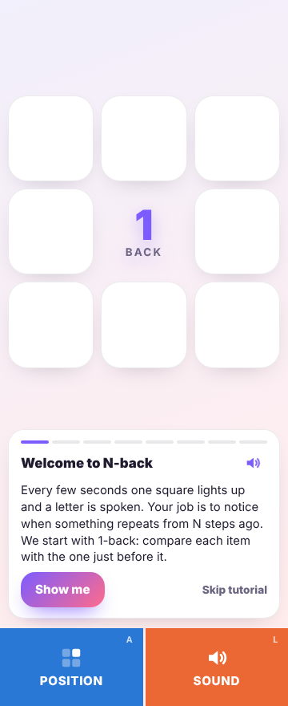
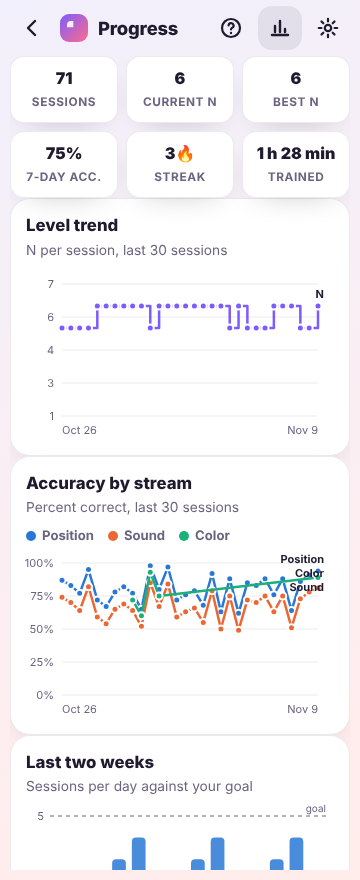

# NBack Trainer

A dual / triple N-back working-memory trainer for Android, designed for foldable phones and built
with Capacitor so the same code also runs as an offline-capable web app. It works on the cover screen, on the inner screen flat or in landscape, and
half-open in tabletop or book posture, where the grid and the controls sit on opposite screens
and nothing straddles the hinge.

| Cover screen | Tabletop (half-open) | Book (half-open) |
|---|---|---|
|  |  |  |

| Results | Guided tutorial | Progress |
|---|---|---|
|  |  |  |

## The game

Follows the dual N-back task from Jaeggi et al. (2008):

- a 3×3 grid where one of the eight outer squares lights up, and one of eight consonants
  (C H K L Q R S T) is spoken at the same time
- a block has 20 + N trials, with 6 position targets and 6 sound targets, 2 of them coinciding
- press **Position** when the square matches the one N steps ago, **Sound** when the letter does
- adaptive level: fewer than 3 errors raises N, more than 5 lowers it (thresholds scale with block length).
  A Relaxed progression option advances at 80% accuracy instead, as most training apps do.
- a 300 ms grace window: a press just after a new item appears still counts for the previous item
  when that item had an unanswered target in that stream

Modes: position only, sound only, dual, and **triple** (adds a colour stream painted on the lit
square, with optional colour names for players who find colours hard to tell apart).

## Features

- **Fold-aware layout**: in the Android app, hinge geometry comes from Jetpack WindowManager
  through a small native plugin. In a browser it falls back to the Viewport Segments API, Window
  Segments, CSS `viewport-segments` media queries with an `env()` probe, and Device Posture events.
  The game pauses automatically when the posture changes mid-session or the app goes to the background.
- **Thumb-first controls**: large stream-coloured buttons in the thumb zone, handedness switch,
  keyboard shortcuts (`A` position, `F` colour, `L` sound, `Space` pause, `Esc` end), haptics,
  tap tones, immediate right/wrong feedback, miss indicators, and a per-trial progress strip.
- **Explainer video**: a two-minute narrated animation of six 2-back turns, with the "two
  turns ago" comparison drawn on a timeline and the rolling-pair memory trick. Offered on first
  launch, on the home screen for new players, and under Settings → Learn. Built from
  `scripts/explainer/` (HTML scenes rendered frame by frame with Chromium, mixed with ffmpeg).
- **Guided tutorial with voice-over**: on first launch the app offers a two-minute interactive
  walkthrough on the real board (position match, sound match, both, no match, what N means, then
  a hinted practice round). Every step is narrated by the same voice that speaks the letters, with
  a mute toggle on the coach card and in Settings. It can be rerun any time from Settings → Learn,
  and a written "How to play" reference is one tap away.
- **Recorded voice and sound design**: the eight letters and every UI sound (correct, wrong,
  miss, countdown tick, go, level up, session complete, achievement) were generated once with
  ElevenLabs and ship as small MP3 files, decoded through Web Audio for low-latency playback.
  Device speech and synthesized tones are the fallbacks if a file cannot load.
- **Record keeping**: every session is stored locally with per-stream hits, misses, false alarms,
  accuracy, mean reaction time, duration, and the resulting N.
- **Trends**: level over time, accuracy per stream, sessions per day against a daily goal,
  a 12-week activity heatmap, personal records, streaks, insights, and a full session log.
- **Daily reminders** (toggle + time): in the Android app, a real scheduled notification that
  repeats daily and skips to the next day once you have trained. In a browser: notifications while
  the page is open, Periodic Background Sync when installed, and a downloadable calendar alarm.
- **Achievements**, daily goal ring, session length (short / standard / long) and pace controls,
  four colour palettes, light/dark/auto theme, data **export** (JSON backup, CSV) and **import**.
- **Also runs as an installable PWA** that works offline; all data stays on the device either way.

## Android app

The game ships as a native Android app built with Capacitor: the web code in `www/` runs inside
an Android shell that adds Jetpack WindowManager fold detection, scheduled reminder notifications,
native haptics, back-button handling, launcher icons and splash screens.

Build it with Android Studio (Hedgehog or newer, JDK 17):

```
npm install
npx cap sync android        # copies www/ into the Android project and updates plugins
npx cap open android        # or: File → Open → the android/ folder in Android Studio
```

Then plug in the phone with USB debugging on and press **Run**. For a shareable debug APK use
**Build → Build Bundle(s) / APK(s) → Build APK(s)**; the file lands in
`android/app/build/outputs/apk/debug/app-debug.apk`, which you can sideload. For the Play Store,
create a signing key in **Build → Generate Signed Bundle / APK** and upload the `.aab`.

**Builds on GitHub.** Every push to `main` runs `.github/workflows/android.yml`, which tests the
web layer, syncs it into the Android project, builds a release APK and app bundle, and replaces the
rolling **dev** prerelease on the Releases page with the new APK. Pushing a tag like `v1.2.0`
publishes a proper release instead. To sign with a stable key (so each build installs over the
last one), add repository secrets `NBACK_KEYSTORE_B64` (`base64 -i nback-release.jks | pbcopy`)
and `NBACK_KEYSTORE_PASSWORD`, plus `NBACK_KEY_ALIAS` / `NBACK_KEY_PASSWORD` if they differ from
`nback` and the keystore password. Without the secrets, dev builds use a throwaway debug key and
tagged releases fail on purpose.

**Release APK to share, built locally.** Create a signing key once (keep the file and passwords safe; the same
key must sign every future update), then build:

```
cd android
keytool -genkeypair -v -keystore nback-release.jks -alias nback -keyalg RSA -keysize 2048 -validity 10000
cp keystore.properties.example keystore.properties   # then fill in the passwords
./gradlew assembleRelease
```

The signed APK is `android/app/build/outputs/apk/release/app-release.apk`. Send that file; the
recipient opens it on their phone and allows installs from the app they opened it with.
`./gradlew bundleRelease` produces the `.aab` for the Play Store instead.

After editing anything in `www/`, run `npx cap sync android` again before building.

Native pieces live in `android/app/src/main/java/com/knightsnavi/nback/`:
`FoldPlugin.java` streams hinge geometry to the web layer, and `MainActivity.java` registers it.
`www/js/native.js` is the JavaScript side of the bridge; every call there is a no-op in a browser,
so the same code also runs as a plain web app.

## Run it in a browser

Any static server works. For example:

```
npm start                   # python3 -m http.server 8080 --directory www
# then open http://localhost:8080/
```

To test fold postures on a desktop browser, add `?posture=tabletop` or `?posture=book`
(optionally `&hinge=28` for the hinge width in CSS px) to the URL.

## Develop

```
npm test                 # engine unit tests (node:test)
node scripts/render-icons.mjs   # regenerate web PNG icons from www/assets/icon.svg
node scripts/android-icons.mjs  # regenerate Android launcher icons, notification icon and splash screens
node scripts/screenshots.mjs    # walk every screen on Z Fold viewports (needs the server on :8080)
TUTORIAL=cover,tabletop node scripts/screenshots.mjs   # drive the guided tutorial end to end
node scripts/explainer/build.mjs                        # rebuild www/video/2back.mp4 (PREVIEW=1 for stills)
```

The engine in `www/js/game.js` is pure and fully covered by `tests/game.test.mjs`. Layout decisions
live in `www/css/styles.css`, keyed off `data-posture`, `data-layout`, `data-width` and `data-handed`
on `<html>`, which `www/js/posture.js` maintains (fed by the native fold plugin inside the app).
